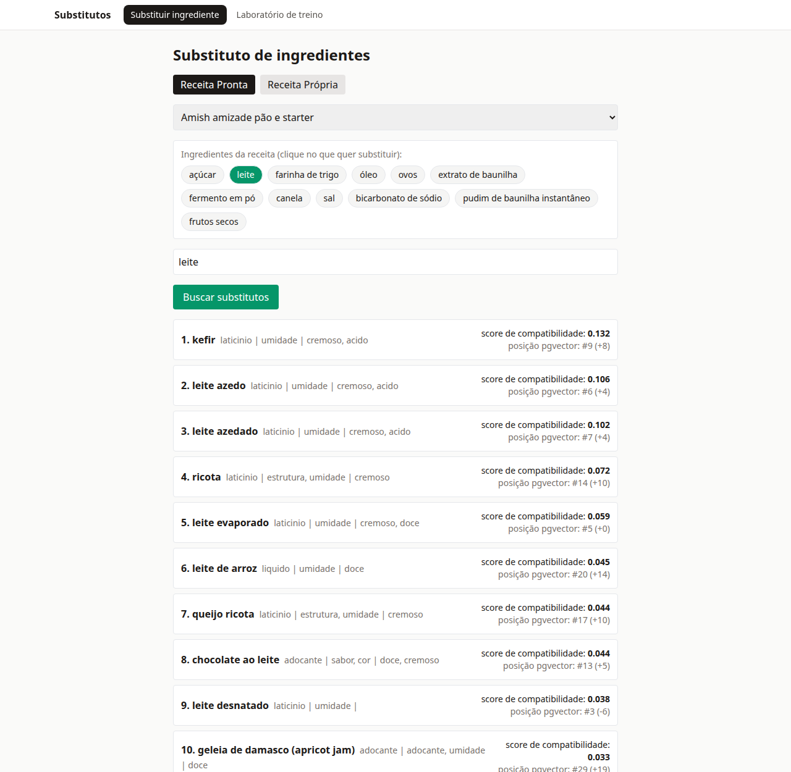
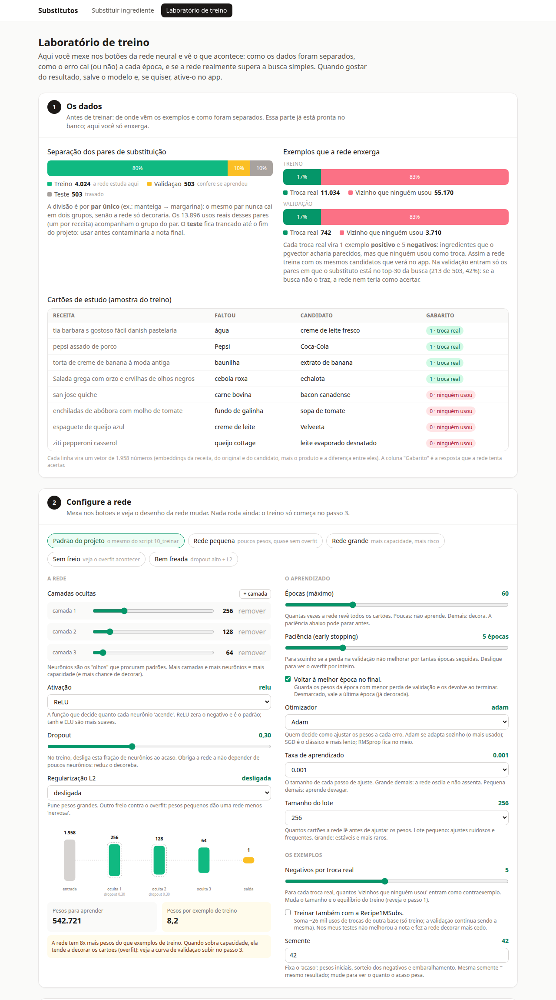

# Recomendador de substituto de ingredientes

Você está fazendo uma receita, falta um ingrediente, e o app sugere o que usar no lugar, levando em conta **a receita inteira** (não só o ingrediente isolado). Manteiga vira óleo num bolo, mas não numa massa folhada.

É um projeto de estudo: o objetivo é entender, na prática, como juntar **embeddings, banco vetorial e uma rede neural rodando no navegador**. O código é comentado em PT-BR para ser relido.

## Como fica

Aba Substituir: escolha uma receita, clique no ingrediente que falta e veja os candidatos reordenados (o score de compatibilidade vem do reranker; a posição original do pgvector aparece ao lado).



Aba Laboratório de treino: separação dos dados, configuração da rede, treino ao vivo e validação contra os baselines.



## A ideia em uma frase

Um banco vetorial (pgvector) acha rápido os 30 candidatos parecidos; uma rede neural pequena (TensorFlow.js, no navegador) reordena esses 30 olhando a receita.

```
ingrediente faltante + receita
        |
        v
React --POST /api/buscar-candidatos--> FastAPI --> pgvector (top-30 por cosseno)
        |                                              |
        |<------ candidatos + embeddings --------------+
        v
Web Worker: tf.tensor2d -> MLP -> sigmoid -> ordena -> lista com score
```

Por que duas etapas:

- **Recuperação (pgvector):** barata, olha o universo todo (1000 ingredientes), mas só mede "parecido com". Não sabe nada da receita.
- **Reranker (TFJS):** caro por candidato, então só vê 30. Recebe a receita como entrada e aprende o que as pessoas de fato trocam.

## Como a recomendação é calculada

Tudo vira vetor e depois tensor:

1. **Texto para vetor.** O modelo `paraphrase-multilingual-MiniLM-L12-v2` (384 dimensões) transforma texto em um vetor normalizado. Isso é feito para cada receita, para cada ingrediente e para o ingrediente faltante.
2. **Banco vetorial.** Os vetores ficam no PostgreSQL com a extensão pgvector (índice HNSW). A busca de candidatos é uma consulta por distância de cosseno.
3. **Vetor para tensor.** Para cada par (ingrediente faltante, candidato) o front monta uma linha de 1958 números:
   `[receita, original, candidato, original*candidato, |original-candidato|, distância do pgvector, categoria/funções/sabores em multi-hot]`
   (5 × 384 + 1 + 37). O produto e a diferença absoluta dão à rede a relação entre os dois ingredientes sem ela ter que descobrir isso sozinha.
4. **Rede.** MLP (camadas densas com ReLU e dropout) terminando em uma sigmoide. A saída é um **score de ranking**, não uma probabilidade calibrada.
5. **Ranking.** Os 30 candidatos entram em um único `predict` em lote e são ordenados pelo score. Tensores são liberados com `tf.tidy`.

O mesmo `feature_spec.json` é usado no treino (Python) e na inferência (JavaScript), e há um teste de paridade que compara a saída do Keras com a do TFJS para as mesmas entradas (diferença na casa de 1e-7).

## De onde vêm os dados

Não existe um dataset público confiável de "X substitui Y". Os pares são minerados de comentários de receitas, como a literatura faz.

1. **Fonte:** [Food.com Recipes and Reviews](https://www.kaggle.com/datasets/shuyangli94/food-com-recipes-and-user-interactions) (Kaggle).
2. **Mineração (`02`):** regras sobre as reviews ("used X instead of Y", "substituted X for Y"). O ingrediente trocado precisa estar na lista da receita, e isso dá o contexto. Precisão estimada em ~90% numa amostra de 50 pares conferida por IA (não por humano).
3. **Limpeza (`03`):** vocabulário dos 1000 ingredientes mais frequentes, com uma lista explícita de ruído ("hand", "garden", "taste"...), descarte de pares triviais (um nome contido no outro) e teto de 20 ocorrências por par para um par popular não dominar.
4. **Taxonomia manual:** categoria, funções (gordura, estrutura, acidez, ligante...) e sabores para cada um dos 1000 ingredientes. Os primeiros 300 foram rotulados à mão; os outros 700 foram rotulados por IA e **ainda precisam de revisão humana**.
5. **Divisão:** 80/10/10 por **par único** (original, substituto). Dividir por ocorrência vazaria o mesmo par para treino e validação. O split `teste` está travado e só deve ser usado uma vez, no fim.
6. **Negativos:** hard negatives do próprio top-30 do pgvector que não são substituições registradas. O reranker treina na mesma distribuição que vai ver em produção.
7. **Tradução:** nomes e receitas em PT-BR (dicionário manual para ingredientes; receitas via Opus-MT/CTranslate2). O nome em inglês continua no banco como chave dos pares.

Resultado: 5.030 pares únicos (4.024 treino / 503 validação / 503 teste), 11.243 receitas, ~66 mil exemplos de treino.

## Estrutura

```
docker-compose.yml     PostgreSQL 16 + pgvector
db/init.sql            tabelas: ingredientes, receitas, receita_ingrediente, pares_substituicao
scripts_ml/            pipeline numerado, rode em ordem
backend/               FastAPI (busca de candidatos, laboratório de treino) + testes
frontend/              React + Vite + TensorFlow.js (inferência em Web Worker)
  src/telas/           aba Substituir
  src/lab/             aba Laboratório de treino
  public/models/       modelo exportado (TFJS) e feature_spec.json
```

Pipeline (`scripts_ml/`):

| Passo | O que faz |
|---|---|
| `01_baixar` | baixa o Food.com |
| `02_minerar_pares` | extrai pares das reviews por regras |
| `03_preparar` | limpeza, vocabulário, ruído |
| `14_rotulos` | funde os rótulos manuais em `taxonomia.json` e na tradução |
| `04_embeddings` | embeddings, carga do banco, split por par único |
| `07a_traduzir_receitas`, `07_receitas` | traduz e carrega receitas e ocorrências |
| `07b`/`07c_recipe1msubs_*` | opcional: pares externos (ver abaixo) |
| `09_dataset`, `10_treinar` | monta exemplos e treina |
| `11_avaliar` | métricas na validação contra baselines |
| `12_exportar`, `13_paridade` | exporta para TFJS e confere paridade |
| `15_experimento_kb` | experimento da base de conhecimento externa |

## Laboratório de treino

Uma aba do app para experimentar sem mexer em código: mostra como os dados foram separados, deixa mudar camadas, neurônios, dropout, L2, otimizador, taxa de aprendizado, lote, épocas, paciência, negativos por positivo e semente, treina com a curva ao vivo, valida contra os baselines, salva (exporta e confere paridade) e ativa no app, com opção de desfazer. O backend não treina: ele lança `scripts_ml/lab.py` como subprocesso e o front consulta o progresso.

## Como rodar

Requisitos: Docker, Python 3.12, Node, uma conta Kaggle (token em `~/.kaggle/kaggle.json` ou `API_TOKEN_KAGGLE` no `.env`). GPU é opcional (só acelera a tradução).

```bash
docker compose up -d                                    # Postgres + pgvector

# ambientes separados: o TF/tf_keras briga com as dependências do backend
python -m venv .venv      && .venv/bin/pip install -r scripts_ml/requirements.txt -r backend/requirements.txt
python -m venv .venv-tf   && .venv-tf/bin/pip install -r scripts_ml/requirements-tf.txt
python -m venv .venv-trad && .venv-trad/bin/pip install -r scripts_ml/requirements-trad.txt

# pipeline de dados e modelo (a pasta data/ não vai para o git)
.venv/bin/python scripts_ml/01_baixar.py
# ... continue na ordem da tabela acima (04 e 07 truncam e recarregam o banco)

cd backend  && ../.venv/bin/uvicorn app.main:app --port 8765
cd frontend && npm install && npm run dev -- --port 5199
# se mudar a porta do front: CORS_ORIGINS="http://localhost:5199" no backend
```

Testes: `cd backend && ../.venv/bin/pytest` e `cd frontend && npm test`.

Observações do ambiente: o treino usa `tf_keras` (`TF_USE_LEGACY_KERAS=1`), não Keras 3, porque o conversor para TFJS tem atrito com o Keras 3. Com Node 24 o tfjs-node precisa de um shim de `util.isNullOrUndefined` (já incluído).

## Resultados

Medidos no split de **validação** (503 pares). "Rankeáveis" são os pares em que o substituto real aparece entre os 30 candidatos (213 de 503); fora disso nenhum reranker consegue acertar.

| Sistema | MRR | R@10 (rankeáveis) |
|---|---|---|
| Popularidade | 0,191 | n/d |
| pgvector sozinho | 0,186 | 0,526 |
| pgvector + reranker TFJS | 0,192 | 0,566 |

Leitura honesta: o reranker supera os baselines, mas por margem pequena. Com 213 pares o erro padrão do R@10 é ~0,03, então a diferença está perto do ruído. O reranker aprende rápido e decora (melhor época 2 ou 3), e o gargalo é a quantidade e a qualidade dos pares, não a rede.

### O que foi tentado e o que aprendemos

- **Mais vocabulário (300 para 1000):** foi o maior ganho em dados, porque o corte em 300 descartava 77% dos pares únicos. Em compensação, o recall dos candidatos caiu e exigiu mudar o embedding do ingrediente para `nome em inglês + 2 x taxonomia`, que subiu o recall@30 de 0,31 para 0,42. A taxonomia manual domina a qualidade da recuperação.
- **Embeddings em PT:** o MiniLM é mais fraco em nomes curtos em português, então o texto embedado continua sendo o nome em inglês; o PT é só de exibição.
- **Recipe1MSubs (GISMo, Meta) como linhas de treino:** 25.834 ocorrências adicionais (8.910 pares que a nossa mineração não tinha). **Não ajudou**: R@10 de 0,531 a 0,548 contra 0,570 só com os dados próprios. Fica disponível como opção desligada no laboratório. Para não contaminar a avaliação, os pares externos só entram no treino e tudo que está na nossa validação ou teste é removido.
- **Recipe1MSubs como base de conhecimento:** aqui o ganho é grande. A base conhece 67% dos pares de validação; unir os 30 vizinhos do pgvector aos substitutos que ela conhece leva o recall dos candidatos de 0,42 para 0,75, e **apenas ordenar pela contagem da base** (desempate por distância) dá MRR 0,209 e R@10 0,457 na régua completa de 503 pares, contra 0,077 e 0,240 do reranker atual. Uma consulta simples, sem rede neural, superou os MLPs testados. Isso **ainda não está no app**, que usa top-30 + reranker.

## Limitações

- Os rótulos vêm de reviews: há ruído, direção (Y para X não implica X para Y) e viés de popularidade.
- Os scores saturam perto de 1 para vários candidatos: servem para ordenar, não para dizer "90% de chance".
- Ingrediente fora do vocabulário (texto livre) devolve vizinhos ruins.
- Parte do ganho da Recipe1MSubs é "acertar o que as pessoas costumam comentar", e os rótulos de validação vêm do mesmo tipo de fonte. Útil para o app, mas não prova que a troca é boa na cozinha.
- 700 dos 1000 rótulos de taxonomia foram feitos por IA e não foram revisados por humano.
- O split `teste` ainda não foi avaliado.

## Créditos e licenças

O código deste repositório é MIT (arquivo `LICENSE`). Os dados e modelos abaixo têm licenças próprias.

- Dados: Food.com Recipes and Reviews (Kaggle; confira os termos do dataset).
- Recipe1MSubs / GISMo (Meta): código sob CC-BY-NC; a licença dos arquivos de dados não é declarada. Uso aqui é pessoal e não comercial, e os dados baixados não vão para o repositório.
- Modelos: `paraphrase-multilingual-MiniLM-L12-v2` (sentence-transformers) e `opus-mt-tc-big-en-pt` (Helsinki-NLP).
